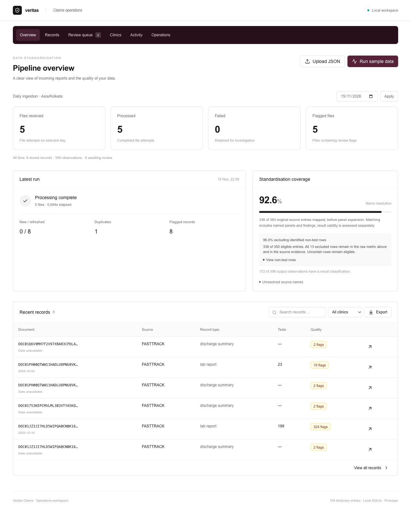

# Veritas Claims medical data standardisation

A local end-to-end prototype that turns inconsistent JSON medical reports into traceable laboratory observations and discharge records. It includes a minimal Next.js operations interface, a configuration-driven Python pipeline, and SQLite persistence.

The original five assignment files are preserved in `sample-data/`. The application exposes uncertainty rather than silently repairing inconsistent source data. This is an operations prototype, not a clinical decision or claims adjudication system.



## Run locally

Requires Node.js 20.9+ and Python 3.10+. No Docker, cloud account, API keys, or Python packages are needed.

```bash
npm run setup
npm run dev
```

Open **http://localhost:3000**, then select **Run sample data**. Upload one or more JSON files with **Upload JSON**. Both services bind to loopback. Stop with Ctrl+C. Ports 3000 and 8000 must be available.

If preferred, start services in separate terminals:

```bash
PYTHONPATH=src python3 -m pipeline.api
npm run dev --prefix web
```

### CLI and checks

```bash
npm run process
PYTHONPATH=src python3 -m pipeline /absolute/path/to/reports
npm test
npm run build
```

Use `--db /path/to/database.sqlite` for an isolated run or `--config /path/to/config` for another configuration directory. Recursive local file discovery simulates object-store batch ingestion. The API also watches `data/inbox/` automatically: drop a JSON file there and open the Operations tab. Use `PYTHONPATH=src python3 -m pipeline --watch data/inbox` for a standalone watcher. Production build can be served with `npm run start --prefix web` alongside the Python API.

## What works

- Automatic folder ingestion with a durable SQLite intake queue, settling detection, pause/resume, and multi-file uploads.
- Failed-file inspection, retry of original or edited JSON, and retained original payloads plus retry history.
- Configurable paths for clinic schemas, tests, patients, medications, metadata, and document identifiers.
- Exact and conservative fuzzy test-name matching with confidence and method recorded.
- Numeric extraction, thousand separators, H/L prefixes, supported linear and temperature unit conversions, demographic and date parsing.
- Configured decomposition of blood-pressure pairs, bilirubin, differential/absolute leukocyte, and named liver-function panels, with source provenance.
- Scalar and interval result validation, open/closed reference limits, and missing-result reasons.
- Numeric range checks, separate configurable outlier rules, qualitative result handling, and explicit invalid reasons.
- Verified medicine mapping with form/instruction normalization, formulation and strength safeguards, ingredient lists, and evidence links. Nineteen product entries resolve 28 sample medication occurrences; 32 remain unresolved, 2 are treatment categories, and 2 are not applicable.
- Configurable record-level content deduplication and database-enforced idempotency.
- Calendar-day ingestion totals with an Apply date filter, searchable records, observation filters, review queue, clinic quality rates, run history, and source/output inspection.
- Explicit version-preserving refresh after configuration or processor changes, with previous outputs and review state retained.
- Wide CSV export and queryable `canonical_wide` SQL view with five fields per test, blank absent tests, and additional rows preserving repeated observations.
- Explicit schema versions, predicate-based profile selection, unknown-version rejection, and a second clinic example.
- Optional masked inspector response that hides patient identifiers, raw source text, and historical identifiers.
- Structured correlation logs, local `/metrics`, observed throughput/latency/lag, and durable threshold alerts with acknowledgement and recovery history.

## Data model and decisions

SQLite stores `runs`, `files`, `records`, `observations`, `reviews`, archived `record_versions`, intake queue, dead letters, retry attempts, settings, and alert tables. Stable record IDs hash a configurable scope plus the source payload. A file commits atomically: if a record is malformed, all changes for that file roll back and a dead-letter entry captures its raw input and error. Other files continue.

The supplied CSV schema describes long-form observations, while FR-2.2 requires wide columns. We retain individual observations in storage and generate both a queryable wide SQL view and a wide export. This preserves repeated tests; the view is rebuilt when the configured test names change. The current CSV has 524 columns; SQL has 525 because it includes an occurrence index. Original source labels, units, values, and raw records remain accessible.

The source `test_analytics` field is not trusted: some samples contain method descriptions or placeholder text there. Classification is recalculated. Unit compatibility is checked before range validation. Supported panels split into individual observations. Unknown components, mismatched result/range counts, incompatible labels/units, and unrecognised text remain intact with review flags. A combined field never becomes an arbitrary first value or midpoint.

## Configuration and onboarding

Edit JSON files in `config/`; the process reloads them at every run:

| File | Purpose |
| --- | --- |
| `clinics.json` | Schema profiles, path mappings, field aliases, duplicate scope |
| `tests.json` | Canonical names, aliases, expected type, canonical units, conversion factors, plausibility limits |
| `ranges.json` | Range policy, demographic reference ranges, qualitative vocabulary, sources |
| `medicines.json` | Exact generic and brand mappings, evidence links |

To onboard a clinic, copy a profile, set a distinctive `match.path`, configure its record/field paths, add supported name/unit aliases, and run a sample with an isolated `--db`. A test demonstrates onboarding a different nested schema and adding a new test entirely through configuration. Profiles use `match.path` and optional `all`/`any` predicates (`exists`, `equals`, `in`), explicit priority, and specificity. Ties and unsupported versions are rejected rather than guessed. Configure `schema_version_path` and `schema_versions` for versioned profiles. `examples/clinic-v2.json` demonstrates the second supported format. Unknown schemas enter the dead-letter store.

Stored records retain a configuration content hash and processor version. Normal reruns skip existing records. After editing configuration, use the overview's **Refresh records with latest mappings** action or run:

```bash
PYTHONPATH=src python3 -m pipeline sample-data --reprocess
```

Only outdated records are recalculated. The stable record ID and first-ingestion timestamp remain; earlier outputs and review state are archived in `record_versions`. Refreshed records return to review. Previous versions are available in the inspector. Failed refreshes roll back the current output and its archive together. Unchanged reruns create no extra versions. UI refresh uses retained source files, which must still be available. UI storage is `data/veritas.sqlite`.

## Sample results and limitations

On a fresh database the five supplied files yield **8 unique records, 363 original source entries, 398 output observations after panel expansion, and 1 suppressed duplicate discharge summary**. A rerun adds no records and suppresses all 9 source record occurrences. Exact counts of classifications depend on the dictionary version.

Name resolution improved from **185/363 (51.0%) to 336/363 (92.6%)**, using the same original-source denominator. The dictionary has 104 canonical entries. Resolved source entries comprise 245 numeric labels, 46 qualitative labels, 8 titres, 30 panels, and 7 narrative findings. Recognising a panel or finding does not imply a valid scalar result. The remaining 27 entries include header/footer artefacts, corrupted labels, and ambiguous observations.

Ten combined source entries produce 45 derived components. Coverage is measured before that expansion so derived children cannot inflate it. The current samples have 172 classified outputs out of 398; the other 226 require review or lack an applicable interpretation. The UI reports both name coverage and classification counts. The 98% production target remains unmet. See `docs/coverage-report.json` for the measured breakdown.

Source reference ranges are used when syntactically valid and units are supported; they are not independently clinically verified. Configured fallback ranges are limited and sourced. Outlier limits are demonstration data-quality rules, not approved physiological limits. Redacted age/gender values remain unknown. Regional medicine mapping is intentionally limited to verified exact entries.

The pipeline does not infer shifted table rows or classify arbitrary narrative findings. Titres require an explicit source threshold and retain their dilution ratio; no universal Widal cutoff is invented. The eight sample titres lack an interpretable source threshold. It retains repeated page observations. Configured panel rules can specify a percentage convention for named differential counts; units for biochemical components are not invented when absent. `Invalid` includes results that cannot be safely classified, with a specific reason. Review acknowledgement does not change source flags or clinical values.

The local app has no authentication, full privacy controls, or external alert delivery. Folder ingestion and its queue persist locally; transient worker failures return to pending, stale processing claims recover after five minutes, and malformed content requires explicit retry. Supported mapping refresh is explicit. Masking is a response/view option, not tokenisation or an access-control boundary. Metrics and UI queries are appropriate for this small prototype; production pagination and scalable aggregation are documented in the architecture. Only supplied/redacted or synthetic data should be used locally.

## Documentation

- [Architecture and production design](docs/architecture.md)
- [Non-functional design notes](docs/non-functional-design.md)
- [Structured assumptions and exclusions](docs/assumptions.md)
- [Requirement coverage and remaining work](docs/coverage.md)
- [Operations runbook](docs/operations.md)
- [References](docs/references.md)
- [Editable architecture diagram](docs/architecture.mmd)

The stack is Next.js App Router, React, TypeScript, Tailwind CSS, locally owned shadcn-style components using Radix Slot/CVA, Python standard library, and SQLite. Dependencies are locked in `web/package-lock.json`.

## Operational metric definitions

Daily file counts use the calendar date in `config/clinics.json` (`Asia/Kolkata` by default). Select a date and click Apply. Received means file processing attempts, including reruns; flagged files contain at least one record flag.

Clinic rates use all processing attempts: duplicate rate = suppressed records / record occurrences; error rate = failed files / file attempts; missing-field rate = missing required demographic fields / expected required fields. Requirements are configured per record type. Redacted values count as missing. Historical attempts recorded before quality contracts existed are excluded from the missing-field denominator. Empty denominators display a dash, not zero.

## Auditable coverage improvement

Version 4 improves raw name resolution from 331/363 (91.2%) to 336/363 (92.6%). Explicit context identifies qualitative glucose in a urine section, an eGFR label continuation, and an explicit creatinine label containing an embedded value. Source values and units are never shifted or invented. Thirteen exact non-test rows (headings, comments, branding, and clinical fields) are tagged but remain stored, invalid, and included in the raw denominator. The additional eligible metric is 336/350 (96.0%); 14 uncertain rows remain eligible. Neither metric reaches 98%.

Medicine additions use manufacturer/regulator evidence, retain formulation suffixes, and restrict incomplete PAN/Fortwin names to explicit injection forms. No dose is inferred. IV Fluids is a treatment category, not a resolved drug. New reference examples cover differential percentages for explicit adults and RDW CV/A:G ratio where the source allows all ages. A clinic's supplied valid range takes priority; reference examples require local laboratory/domain approval.

Reproduce the baseline without modifying the main database:

```bash
PYTHONPATH=src python3 scripts/measure_coverage.py
```

The UI uses the approved deep burgundy navigation (#2D0E1B), muted active tabs, and neutral content surfaces.
