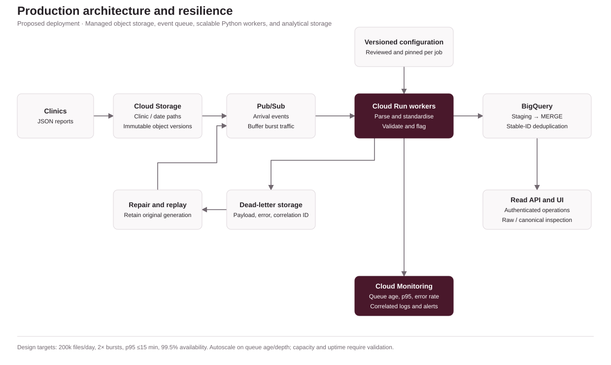

# Solution architecture

Veritas needs comparable, auditable observations from heterogeneous medical reports. The prototype prioritises deterministic transformations, preserved source evidence, configurable onboarding, and visible uncertainty. It implements local ingestion, processing, storage, and review; managed services below are the production design.

[Implemented local architecture](diagrams/local-architecture.svg) · [Production controls](diagrams/production-controls.svg) · [Editable Draw.io document](diagrams/veritas-architecture.drawio)

## Ingestion and processing

In production, clinics land immutable objects under a clinic/date prefix. Pub/Sub delivers object notifications at least once. Workers fetch the exact object generation, select a versioned clinic profile, extract records, normalise names and supported units, validate, and emit canonical records with a configuration hash. Unknown mappings remain flagged. Runtime mapping uses schema-on-read; storage has explicit canonical fields.

The local equivalent recursively reads a folder, watches stable JSON arrivals through a persistent intake queue, or accepts uploads through Next.js. A loopback Python HTTP service shares the same processing engine as the CLI. Uploads are retained locally. Each file has its own SQLite transaction, isolating a malformed file from the rest of the batch. Parsing failures preserve input and reason in `data/dead-letter/`. Original and corrected retry payloads remain linked in an audit trail. Queue state and watcher pause survive restarts; stale claims recover. Logs carry a run correlation ID and source path.

## Storage and configuration

SQLite provides relational `records`, queryable `observations`, `files`, `runs`, `reviews`, and archived `record_versions`. Each record retains raw JSON, source location, document identity, timestamps, clinic proxy, and configuration hash. The supplied long-form schema is represented by canonical observation columns with extra output details in JSON. A generated `canonical_wide` SQL view and CSV satisfy five columns per configured test; repeated occurrences produce additional rows rather than overwriting results.

JSON configuration defines clinic paths, aliases, unit factors, reference rules, and medicines. New schema profiles and tests require configuration edits only within the supported path-based grammar. Onboarding includes validating a sample, examining unresolved mappings, and testing units before rollout. Version predicates, priority, and specificity select profiles; ties and unsupported versions fail safely. Production configuration is reviewed, versioned, validated, and pinned per job; historical decisions remain reproducible.

## Reliability and replay

A stable hash covers configurable record identity fields plus the source payload. SQLite primary keys prevent duplicate rows on reruns. The default scope includes clinic, document ID, and record type: distinct encounters with identical results are not automatically collapsed. Exact duplicates within a document are suppressed, while repeated observations inside a report are retained and flagged. Near-duplicate reports across different document IDs require an additional domain-approved identity policy.

Production workers acknowledge a message only after durable output. Retry transient failures with backoff, send poison messages to a dead-letter topic, and replay corrected records using the original object generation and selected config version. BigQuery staging and periodic MERGE deduplicate by stable IDs; avoid per-observation synchronous inserts. Corrected source documents need explicit revision identities and supersession relationships. Local explicit replay recalculates outdated configuration/processor versions, archives earlier output and review state, and retains stable IDs and first-ingestion timestamps. A failed file rolls back updates and archives together. Unchanged replay is a no-op.

## UI and operational visibility

Next.js presents calendar-day file totals, name-resolution coverage, records, flags, review acknowledgement, clinic duplicate/error/missing-field rates, prior versions, source/output inspection, masked inspector responses, failed-file repair, and watcher controls. The server proxies a fixed set of routes to Python. Local services bind to loopback and are intended for redacted samples. Throughput, local p95 latency, error rate, and queue age feed durable threshold alerts with acknowledgement/recovery history and `/metrics`. Masking is optional per response and does not restrict other routes. A production read service requires authenticated operations roles, field masking, access audit logs, pagination, and precomputed metrics. Read-only viewers and reviewers should have distinct permissions. A review acknowledgement records workflow state; it does not adjudicate a claim or change medical evidence.

## Assumptions

JSON lands under a known clinic/date convention; one file may contain multiple document types. Sample metadata identifies source systems rather than reliable clinic identities, so source system is the local proxy. Redacted identifiers are not usable for patient matching. Source reference ranges may themselves be wrong; compatibility checks catch some contradictions, but domain approval is needed. Composite or shifted extractions require review rather than inferred correction.

See [non-functional design notes](non-functional-design.md) for scale, onboarding, availability, governance, and observability. Drawings are available as SVG and PNG under `diagrams/`, with a three-page editable Draw.io document. The Mermaid source is in `architecture.mmd`.
